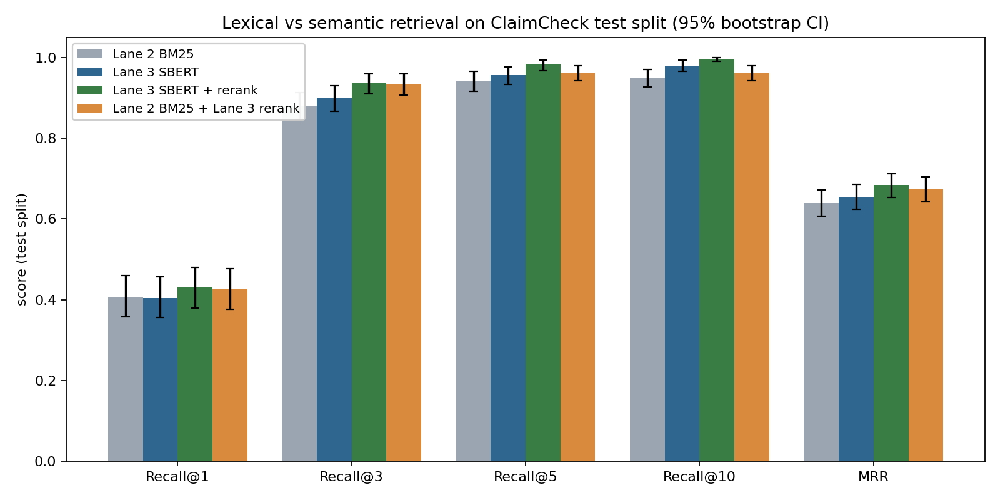

# ClaimCheck

**Evidence-based claim verification — retrieve, rerank, verify, explain.**

36118 Applied Natural Language Processing (ANLP), Spring 2026 — AT2 Part B group project.

Given a factual claim, ClaimCheck retrieves the evidence sentences most relevant to it, reranks them for precision, and classifies the claim as **SUPPORTS**, **REFUTES**, or **NOT ENOUGH INFO** using natural language inference — all exposed through an interactive web app, not just a script. The headline result: a zero-shot DeBERTa-v3 verifier reaches **78.9% accuracy** on gold evidence against a 54.9% majority-class baseline, evaluated with 95% bootstrap confidence intervals and paired significance tests throughout, not single-run point estimates.

**Team:** Vignesh Selvam · Delishiya Martin Devaraj · Nandeeswari Kumaravelu · Pranav Shalmraj · Sivadarshan

---

## Contents

- [Architecture](#architecture)
- [Key results](#key-results)
- [Project structure](#project-structure)
- [The shared interface contract](#the-shared-interface-contract)
- [Getting started](#getting-started)
- [Running the application](#running-the-application)
- [Running Lane 1's data & evaluation pipeline](#running-lane-1s-data--evaluation-pipeline)
- [Data provenance](#data-provenance)
- [Ethical considerations & limitations](#ethical-considerations--limitations)

---

## Architecture

```
  Claim                Retrieve              Rerank              Verify              Verdict             Web App
┌──────────┐        ┌─────────────┐       ┌─────────────┐     ┌─────────────┐     ┌─────────────┐     ┌───────────┐
│  user    │  ───▶  │ BM25/TF-IDF │  ───▶ │ cross-       │ ──▶ │ DeBERTa-v3  │ ──▶ │ SUPPORTS /  │ ──▶ │ Streamlit │
│  input   │        │ or SBERT +  │       │ encoder      │     │ zero-shot   │     │ REFUTES /   │     │ UI        │
│          │        │ FAISS       │       │ reranking    │     │ NLI         │     │ NEI + conf. │     │           │
└──────────┘        └─────────────┘       └─────────────┘     └─────────────┘     └─────────────┘     └───────────┘
   (user)              Lane 2 / 3             Lane 3              Lane 4            Lanes 1 + 4           Lane 5
```

Every stage implements the same three-function contract below, so any retriever feeds any reranker feeds the verifier without the lanes needing to know each other's internals — which is what let five people build this in parallel.

## Key results

| Metric | Result | Detail |
|---|---|---|
| Verification accuracy (gold evidence) | **78.9%** [74.6, 83.2] | DeBERTa-v3 zero-shot NLI vs. a 54.9% majority-class baseline and a 40.8% TF-IDF + Logistic Regression baseline |
| Retrieval Recall@5 | **98.3%** [96.8, 99.4] | SBERT + cross-encoder rerank, a significant gain over BM25 alone (94.2%, p < 0.001) |
| Evidence-quality ablation | 78.9% → **40.5%** | Accuracy collapses once the verifier sees only the top-1 retrieved sentence instead of gold evidence — the pipeline's real bottleneck is retrieval precision, not classification |
| Lexical-overlap shortcut baseline | 56.9% vs. 45.1% | A single word-overlap feature alone separates SUPPORTS/REFUTES; DeBERTa-v3 clears this baseline by over 20 points, evidence it reasons over meaning rather than surface overlap |

All numbers are reproducible — see [Running the application](#running-the-application) and each lane's own `results/` folder for the full tables, confidence intervals and significance tests.

<p align="center">
  
  
</p>

## Project structure

| Folder | Lane | Owner | Core deliverable |
|---|---|---|---|
| `lane1_data_eval/` | Data, Evaluation & Innovation Lead | Vignesh Selvam | Dataset pipeline, shared evaluation harness (Recall@K, MRR, Macro-F1, FEVER Score, bootstrap CIs, significance tests), bias analysis |
| `lane2_retrieval_traditional/` | Traditional Retrieval | Delishiya Martin Devaraj | BM25 + TF-IDF retrieval (`retrieve`) |
| `lane3_retrieval_modern/` | Modern Retrieval | Nandeeswari Kumaravelu | Sentence-BERT + FAISS retrieval, cross-encoder reranking (`retrieve`, `rerank`) |
| `lane4_verification/` | Verification / NLI | Pranav Shalmraj | Zero-shot DeBERTa-v3 NLI verifier, TF-IDF + LogReg baseline (`verify`) |
| `lane5_webapp/` | Web App & Explainability | Sivadarshan | Streamlit app wiring every lane end to end |

Each lane folder has its own `README.md` with exact steps, methods and results — start there for lane-specific detail.

## The shared interface contract

Agreed on Day 0, implemented identically by all four pipeline lanes, and the reason five people could build this in parallel without blocking each other:

```python
def retrieve(claim: str, k: int) -> list[str]:
    """Return top-k evidence_id strings, ranked best-first."""

def rerank(claim: str, candidates: list[str], top_n: int) -> list[str]:
    """Re-order/filter candidate evidence_ids down to top_n, best-first."""

def verify(claim: str, evidence: str) -> dict:
    """Return {"label": "SUPPORTS"|"REFUTES"|"NOT ENOUGH INFO", "confidence": float}."""
```

Lane 1 built the shared evaluation harness every other lane scores against (`lane1_data_eval/scripts/evaluation.py` — `recall_at_k`, `mean_reciprocal_rank`, `accuracy`, `macro_f1`, `confusion_matrix_df`, `fever_score`, `bootstrap_ci`, `paired_bootstrap_test`). Nobody else re-implements metrics — import from there.

## Getting started

```bash
git clone https://github.com/vigneshcrack/CLAIMCHECK.git
cd CLAIMCHECK
pip install -r requirements.txt
```

Requires Python 3.10+. First run downloads the SBERT, cross-encoder and DeBERTa-v3 checkpoints from Hugging Face (a few hundred MB, one-time).

## Running the application

```bash
streamlit run lane5_webapp/app.py
```

Opens the full pipeline in your browser: type a claim, choose a retrieval method (BM25, TF-IDF, SBERT, SBERT + rerank, BM25 + rerank) and a top-k, and get a verdict with its evidence, confidence, and a plain-English explanation — including an explicit, honest disclosure of the system's own scope and limitations in the app itself.

## Running Lane 1's data & evaluation pipeline

```bash
cd lane1_data_eval
pip install -r requirements.txt
python -I run_pipeline.py
python -m pytest tests/ -v
```

Reproduces the dataset build, EDA figures, evaluation harness validation, and lexical-overlap bias analysis from scratch. See `lane1_data_eval/README.md` for full details.

## Data provenance

The full FEVER dataset and Wikipedia evidence corpus could not be downloaded in the build environment (`fever.ai`, `huggingface.co`, `s3.amazonaws.com` were network-blocked). ClaimCheck is built instead on **FeverSymmetric** (Schuster et al., EMNLP 2019) — a real, peer-reviewed, labelled derivative of FEVER, not fabricated data — over a 648-sentence evidence corpus sampled from it. Two scope decisions are disclosed throughout the code and the report rather than hidden: 40 synthetic `NOT ENOUGH INFO` placeholder rows (tagged `source="synthetic_nei_placeholder"`, never reported as real data), and a retrieval corpus smaller than the full Wikipedia knowledge base.

## Ethical considerations & limitations

- A verdict's confidence score is the NLI model's own softmax probability, **not** a calibrated estimate of real-world correctness.
- `NOT ENOUGH INFO` is a deliberate abstention when evidence conflicts, not a failure state — the app states this explicitly rather than implying the claim is false.
- The lexical-overlap bias analysis (`lane1_data_eval/scripts/bias_analysis.py`) shows this dataset slice contains a measurable, exploitable shortcut signal; results should be read with that confound in mind.
- This is an academic research artifact, not a deployed fact-checking product, and its verdicts are not presented as authoritative.

---

*Commit history on this repository is used as evidence of individual contribution for the report's "project phases and contributions" section and for SPARKPlus peer evaluation — every lane commits its own work directly.*
