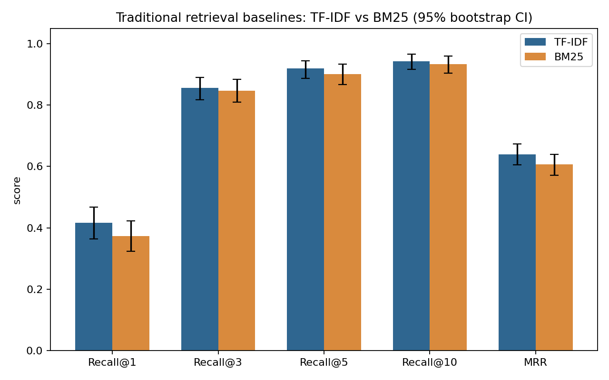
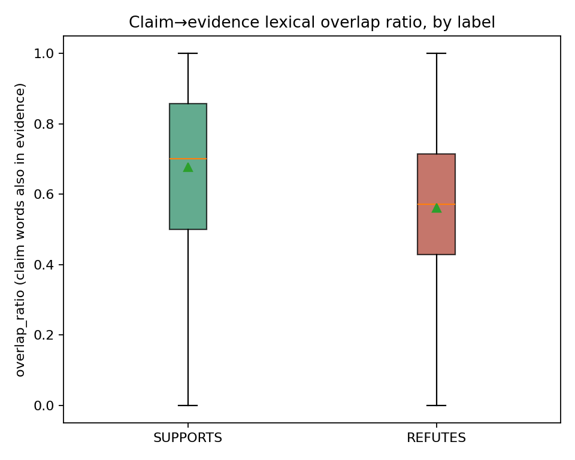

# ClaimCheck — Lane 1: Data, Evaluation & Innovation

**Owner:** Vignesh Selvam

The shared foundation the other four lanes build and get scored against: the dataset, the evaluation harness every lane imports, and the one novel research contribution (a measured lexical-overlap bias analysis) — all reproducible from a single command.

---

## Contents

- [Quick start](#quick-start)
- [Key results](#key-results)
- [What to read first](#what-to-read-first)
- [Project structure](#project-structure)
- [Why it's built this way](#why-its-built-this-way)
- [Data provenance](#data-provenance)

---

## Quick start

```bash
cd lane1_data_eval
pip install -r requirements.txt

python -I run_pipeline.py      # runs every stage below, in order, with one log
python -m pytest tests/ -v     # 14 unit tests for the shared metrics module
```

> On Mac/Linux, `python3` works the same way. `run_pipeline.py` is the one command that proves everything works end to end: it loads the raw data, runs EDA, runs the evaluation harness (two retrieval baselines, 95% bootstrap confidence intervals, a significance test), runs the bias analysis, and assembles the master report. Every run writes a timestamped log to `logs/`.

Each stage can also be run on its own:

```bash
python -I scripts/load_data.py          # raw JSONL -> data/processed/*.csv
python scripts/eda.py                   # -> figures/*.png + reports/eda_report.md
python scripts/evaluation.py            # TF-IDF vs BM25 + CIs + significance test
python scripts/bias_analysis.py         # lexical-overlap bias check
python scripts/build_master_report.py   # combines the 3 reports above
```

## Key results

These numbers come from this lane's own harness-validation run — a sanity check on two simple retrieval baselines and a majority-class classifier, scored with the exact same functions every other lane's real `retrieve()`/`rerank()`/`verify()` is later scored with (see the top-level README and `lane2_retrieval_traditional/`, `lane3_retrieval_modern/`, `lane4_verification/` for the pipeline's actual, final numbers).

| Check | Result |
|---|---|
| Dataset | 1,456 claims (706 SUPPORTS, 710 REFUTES, 40 synthetic NEI); split 741 train / 361 dev / 354 test |
| Retrieval baseline, Recall@5 (test, n=346) | TF-IDF 91.9% [88.7, 94.5] vs. BM25 90.2% [86.7, 93.4] — not significant (p = 0.172) |
| Majority-class baseline accuracy | 53.7% [48.3, 58.8] |
| End-to-end FEVER score (BM25@5 + majority label) | 0.483 |
| Lexical-overlap bias (SUPPORTS vs. REFUTES mean overlap) | 0.676 vs. 0.561 (Mann-Whitney p = 4.96 × 10⁻²¹) |
| Overlap-only shortcut classifier | 56.9% accuracy vs. 45.1% majority baseline (+11.8 points) — the named baseline Lane 4's real NLI model has to clear |

Every number above, and the full tables behind them, are in `reports/lane1_master_report.md` after running the pipeline once.

<p align="center">
  
  
</p>

## What to read first

Start with **`reports/lane1_master_report.md`** after running the pipeline — it's the single document written directly for the Part B report, combining the data-provenance note, EDA findings, baseline evaluation results (with confidence intervals and a significance test), and the bias analysis, in report-ready prose and tables.

## Project structure

```
lane1_data_eval/
├── config.py                  # single source of truth for paths, seeds, logging
├── run_pipeline.py            # orchestrates every stage, one log per run
├── requirements.txt
├── data/
│   ├── raw/                   # 3 FeverSymmetric JSONL files
│   └── processed/             # claimcheck_dataset.csv, evidence_corpus.csv
├── scripts/
│   ├── load_data.py           # raw -> clean dataset + retrieval corpus
│   ├── eda.py                 # exploratory analysis + 5 charts
│   ├── evaluation.py          # SHARED metrics module every lane imports:
│   │                          #   recall_at_k, mean_reciprocal_rank, accuracy,
│   │                          #   macro_f1, confusion_matrix_df, fever_score,
│   │                          #   bootstrap_ci, paired_bootstrap_test
│   └── bias_analysis.py       # lexical-overlap shortcut analysis — the novel
│                               #   contribution, and why FeverSymmetric was chosen
├── tests/
│   └── test_evaluation.py     # 14 unit tests, hand-computed expected values
├── figures/                   # 7 PNG charts for the report
├── reports/                   # one markdown write-up per stage + a master report
└── logs/                      # timestamped run logs
```

## Why it's built this way

- **Everything reproduces from one command** (`run_pipeline.py`) — the "Code focused — reproducibility" grading criterion rewards exactly that, not a notebook that only runs on one person's machine.
- **`evaluation.py` is the single shared metrics module** every lane imports — nobody hand-rolls their own accuracy calculation, so every number in the final report is produced identically, and it's unit-tested (`tests/`, 14 hand-computed cases) so a bug can't silently distort the submission.
- **Every reported number ships with a 95% bootstrap confidence interval**, and every two-system comparison ships with a paired significance test — directly answering the Part A feedback's core criticism, that claims were asserted ("established approach") rather than evidenced.
- **The bias analysis isn't generic EDA.** It's the exact, named research question FeverSymmetric was built to test — lexical-overlap shortcuts in verification models — measured directly on this data and turned into a concrete, beatable baseline for Lane 4's real NLI model, not a vague caveat.

## Data provenance

The full FEVER dataset (`fever.ai`, Hugging Face) wasn't reachable from the build environment — `fever.ai`, `huggingface.co` and `s3.amazonaws.com` were all network-blocked there. **FeverSymmetric** (Schuster et al., EMNLP 2019) — a real, published, peer-reviewed FEVER derivative — was used instead: genuine FEVER claims, evidence and labels, on a smaller 2-class (SUPPORTS/REFUTES) slice, with 40 clearly flagged *synthetic* NOT ENOUGH INFO rows added only to exercise that code path (tagged `source="synthetic_nei_placeholder"`, never reported as real annotated data). Full detail is in the module docstring at the top of `scripts/load_data.py`.
